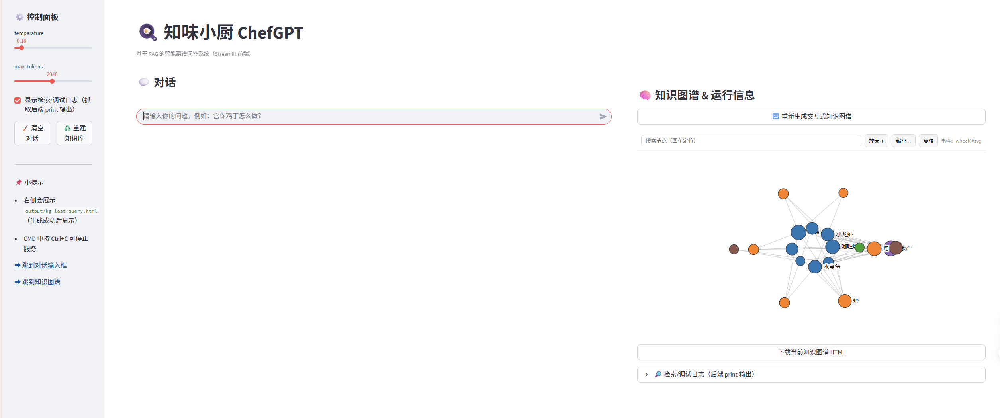
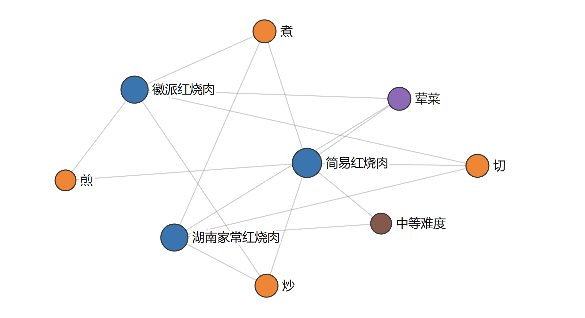

# 🍳 知味小厨 ChefGPT

基于 **RAG（检索增强生成）** 的中文菜谱问答项目。ChefGPT 从本地 Markdown 菜谱中检索相关内容，再结合大语言模型回答食材用量、制作步骤和烹饪技巧等问题；同时提供命令行与 Streamlit 网页界面。

> 图为课程报告中的运行截图。仓库代码和当前运行环境决定实际显示效果。

## 能做什么

| 场景 | 示例提问 | 系统处理 |
| --- | --- | --- |
| 查询做法 | “红烧肉怎么做？” | 检索菜谱，整理食材与步骤 |
| 连续追问 | “它需要放糖吗？” | 结合对话历史重写问题，继续查找相关菜谱 |
| 近义表达 | “番茄炒蛋怎么做？” | 利用语义检索寻找“西红柿炒鸡蛋”等相关内容 |
| 查看关联 | 查看检索结果的知识图谱 | 展示菜品与食材、工艺、分类和难度的关系 |

网页界面还提供生成参数调节、清空对话、重建知识库和检索日志查看。知识图谱由本地菜谱提取并生成交互式 HTML，可在界面中查看。

## 系统如何工作

~~~mermaid
flowchart LR
    A[Markdown 菜谱] --> B[解析与标题切分]
    B --> C[子文档向量化]
    C --> D[FAISS 本地索引]
    B --> E[父文档与元数据]
    B --> K[实体关系抽取]
    K --> H[交互式知识图谱]

    Q[用户问题] --> R{意图路由}
    R -->|菜谱问题| W[结合历史重写问题]
    W --> S[FAISS 与 BM25 候选召回]
    D --> S
    S --> T[RRF 排序]
    T --> P[回溯完整菜谱]
    E --> P
    P --> L[DashScope 模型生成回答]
    R -->|闲聊| L
    L --> O[回答与对话历史]
    P --> H
~~~

项目对应课程报告中的四个 RAG 环节：

1. **数据准备**：读取菜谱 Markdown，按标题切分子文档，保留完整菜谱作为父文档，并提取菜名、分类、难度等元数据。
2. **索引构建**：使用 BAAI/bge-small-zh-v1.5 生成向量，在本地 FAISS 中保存和加载索引。
3. **检索处理**：生成 FAISS 与 BM25 两路候选，按 RRF 分数排序，再回溯命中的完整菜谱。
4. **生成回答**：识别提问意图，结合对话历史重写问题，将相关菜谱交给模型生成回复。闲聊问题直接交给模型处理。

**当前实现说明：**检索模块虽然计算 BM25 候选，但 BM25 权重目前设为 0，默认排序实际以向量检索为主。课程报告中的“双路融合”描述对应设计目标；若要启用 BM25 对排序的贡献，可调整 [检索模块](rag_modules/retrieval_optimization.py) 中的权重并重新评估效果。知识图谱用于展示关联，目前未参与检索排序。

## 快速开始

### 1. 获取项目并安装依赖

需要 **Python 3.10 或更新版本**。在项目根目录创建虚拟环境后安装依赖：

~~~bash
git clone https://github.com/shimotsuki-haruka/ChefGPT.git
cd ChefGPT
python -m venv .venv
~~~

激活环境：

~~~powershell
# Windows PowerShell
.\.venv\Scripts\Activate.ps1
~~~

~~~bash
# Linux / macOS
source .venv/bin/activate
~~~

~~~bash
python -m pip install -r requirements.txt
~~~

### 2. 配置模型密钥

当前代码使用阿里云 DashScope 的 OpenAI 兼容接口，默认模型为 deepseek-v3.2-exp。在项目根目录新建 .env，填写自己的密钥：

~~~dotenv
DASHSCOPY_API_KEY=your_api_key_here
~~~

.env 已被 .gitignore 排除。也可以直接设置同名系统环境变量。请勿将真实密钥写入源码或提交到仓库。

### 3. 启动

网页界面：

~~~bash
python -m streamlit run frontend_improve.py
~~~

命令行界面：

~~~bash
python main.py
~~~

首次运行会下载中文嵌入模型，并根据 data/cook/dishes/ 中的菜谱构建本地索引；所需时间取决于网络和设备性能。后续运行会尝试加载 vector_index/ 中的缓存。与模型对话需要可用的 DashScope API Key 和网络连接。

## 项目结构

~~~text
ChefGPT/
├── config.py                         # 数据路径、嵌入模型和生成参数
├── main.py                           # RAG 系统与命令行入口
├── frontend.py                       # 基础 Streamlit 界面
├── frontend_improve.py               # 带知识图谱和调试面板的网页界面
├── rag_modules/
│   ├── data_preparation.py           # 菜谱解析、切分和知识图谱
│   ├── index_construction.py         # 嵌入模型与 FAISS 索引
│   ├── retrieval_optimization.py     # 候选召回与排序
│   └── generation_integration.py     # 问题重写、路由与答案生成
├── data/cook/dishes/                # 菜谱 Markdown 与图片
├── docs/images/                     # 本 README 使用的报告截图
├── requirements.txt
└── README.md
~~~

运行时生成的 vector_index/ 和 output/ 已在 .gitignore 中排除。后者保存知识图谱 HTML 等本地生成结果。

## 数据与已知限制

- 菜谱数据参考 [HowToCook](https://github.com/Anduin2017/HowToCook)。知识图谱通过规则和关键词从菜谱中提取，复杂语句可能出现漏提取或误提取。
- 菜品分类依赖文件夹结构；移动菜谱文件后，分类结果可能变化。
- 当前仓库中的多数菜谱图片是 Git LFS 指针文件，原始图片对象在上游仓库无法获取，因此这些图片暂时不能正常显示。菜谱文本和问答流程不依赖图片。
- 模型回答仍可能出错；对食材安全、过敏原和烹饪温度等重要信息，请结合原始菜谱核对。

## 许可

项目代码遵循仓库中的 [MIT License](LICENSE)。菜谱数据及图片的来源请参阅上方致谢与各文件中的原始说明。
