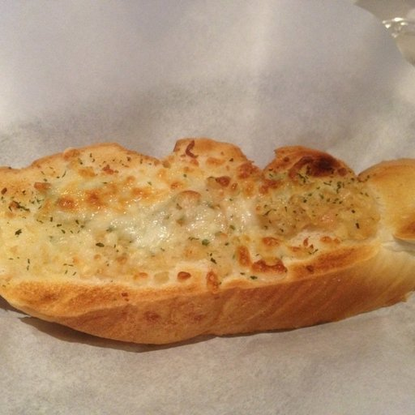
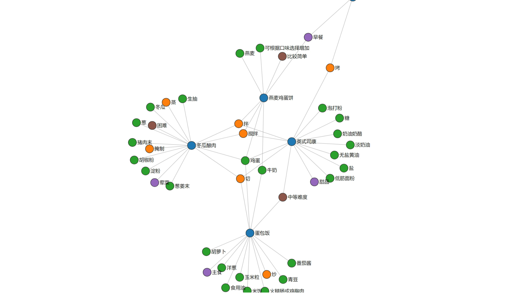
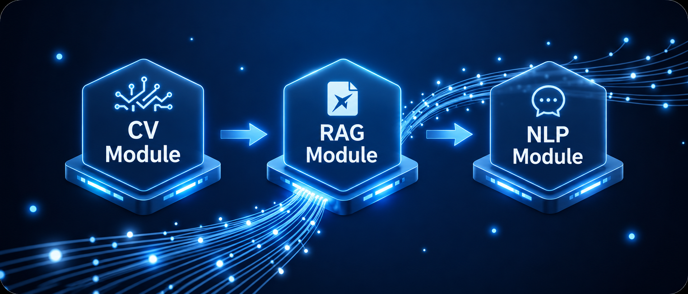

# 🍳 知味小厨 ChefGPT 2.0

基于 **RAG（检索增强生成）** 的中文菜谱问答项目。ChefGPT 从本地 Markdown 菜谱中检索相关内容，再结合大语言模型回答食材用量、制作步骤和烹饪技巧等问题；2.0 在文字问答之外加入**食物照片分类与自动提问**，同时提供命令行和两种 Streamlit 网页界面。

> 网页界面示例：左侧对话，右侧展示菜谱关联。

## 2.0 相比 1.0 新增了什么

1.0 的主线是**文字提问 → 菜谱检索 → 模型回答**，并提供菜谱知识图谱。2.0 保留这条流程，增加了**图片输入 → 本地食物分类 → 自动生成菜谱问题**的入口。

| 能力 | 1.0 | 2.0 |
| --- | --- | --- |
| 菜谱文字问答与连续追问 | 支持 | 保留 |
| 菜谱知识图谱 | 支持 | 保留 |
| 上传食物照片 | — | Streamlit 页面可上传，直接在内存中识别 |
| 识别食物类别 | — | 本地 CNN 模型输出 11 个大类之一 |
| 根据识别结果提问 | — | 自动生成推荐问题，也可改写后再查询 |
| 命令行图片输入 | — | 支持 `img <图片路径>` |

照片识别为食物类别后，系统会自动生成菜谱推荐问题，并接入原有的 RAG 问答流程。用户也可以根据需要修改问题。

### 从照片到菜谱：一个可复现的例子

使用示例图片运行 `img chefGPT-test/bread.jpg`，模型会识别为 **Bread（面包）**，并生成“我想做一道面包，有什么推荐做法吗？”。按回车即可用这个问题查询菜谱，也可以输入自己的问题。

## 能做什么

| 场景 | 示例提问 | 系统处理 |
| --- | --- | --- |
| 查询做法 | “红烧肉怎么做？” | 检索菜谱，整理食材与步骤 |
| 连续追问 | “它需要放糖吗？” | 结合对话历史重写问题，继续查找相关菜谱 |
| 近义表达 | “番茄炒蛋怎么做？” | 利用语义检索寻找“西红柿炒鸡蛋”等相关内容 |
| 拍照识菜 | 上传一张食物照片 | 本地模型识别大类，生成菜谱推荐问题 |
| 查看关联 | 查看检索结果的知识图谱 | 展示菜品与食材、工艺、分类和难度的关系 |

**拍照识菜界面**支持上传照片、识别食物类别并自动提问；**知识图谱界面**提供对话、参数滑块、重建知识库和检索日志。两者共用同一个 RAG 后端，启动命令见下文。

> 蓝色节点表示菜品，绿色表示食材，橙色表示做法，紫色表示分类，棕色表示难度。

## 系统如何工作

> 上传照片后，本地图像模型预测食物类别，并将类别转换为自然语言问题；问题随后进入菜谱检索与回答流程。下方流程图展示具体步骤。

~~~mermaid
flowchart LR
    A[Markdown 菜谱] --> B[解析与标题切分]
    B --> C[子文档向量化]
    C --> D[FAISS 本地索引]
    B --> E[父文档与元数据]
    B --> K[实体关系抽取]
    K --> H[交互式知识图谱]

    I[食物照片] --> M[本地图像分类模型]
    M --> N[11 类食物标签]
    N --> J[生成菜谱问题]
    J --> Q
    Q[用户问题] --> R{意图路由}
    R -->|菜谱问题| W[结合历史重写问题]
    W --> S[检索相关菜谱]
    D --> S
    S --> T[排序相关结果]
    T --> P[回溯完整菜谱]
    E --> P
    P --> L[DashScope 模型生成回答]
    R -->|闲聊| L
    L --> O[回答与对话历史]
    P --> H
~~~

菜谱问答由四个环节组成：

1. **数据准备**：读取菜谱 Markdown，按标题切分子文档，保留完整菜谱作为父文档，并提取菜名、分类、难度等元数据。
2. **索引构建**：使用 BAAI/bge-small-zh-v1.5 生成向量，在本地 FAISS 中保存和加载索引。
3. **检索处理**：查找相关菜谱片段，排序后回溯完整菜谱；向量检索与 BM25 的排序权重可以按需调整。
4. **生成回答**：识别提问意图，结合对话历史重写问题，将相关菜谱交给模型生成回复。闲聊问题直接交给模型处理。

检索策略可在 [检索模块](rag_modules/retrieval_optimization.py) 中调整；知识图谱提供直观的菜谱关联视图。

## 快速开始

### 1. 获取项目并安装依赖

需要 **Python 3.10 或更新版本**。在项目根目录创建虚拟环境后安装依赖：

~~~bash
git clone https://github.com/shimotsuki-haruka/ChefGPT.git
cd ChefGPT
python -m venv .venv
~~~

激活环境：

~~~powershell
# Windows PowerShell
.\.venv\Scripts\Activate.ps1
~~~

~~~bash
# Linux / macOS
source .venv/bin/activate
~~~

~~~bash
python -m pip install -r requirements.txt
~~~

如需使用**拍照识菜**功能，再安装图像识别依赖：

~~~bash
python -m pip install -r requirements-vision.txt
~~~

### 2. 配置模型密钥

当前代码使用阿里云 DashScope 的 OpenAI 兼容接口，默认模型为 deepseek-v3.2-exp。在项目根目录新建 .env，填写自己的密钥：

~~~dotenv
DASHSCOPY_API_KEY=your_api_key_here
~~~

.env 已被 .gitignore 排除。也可以直接设置同名系统环境变量。请勿将真实密钥写入源码或提交到仓库。

### 3. 启动

拍照识菜网页界面（需安装图像识别依赖）：

~~~bash
python -m streamlit run frontend.py
~~~

知识图谱与调试网页界面：

~~~bash
python -m streamlit run frontend_improve.py
~~~

命令行界面：

~~~bash
python main.py
~~~

命令行中可直接输入菜谱问题，也可以输入 **img chefGPT-test/bread.jpg**。识别后按回车使用自动生成的推荐问题，或输入自己的问题。模型支持面包、汤、海鲜等 **11 个食物类别**。

首次运行会下载中文嵌入模型，并根据 data/cook/dishes/ 中的菜谱构建本地索引；所需时间取决于网络和设备性能。后续运行会尝试加载 vector_index/ 中的缓存。与模型对话需要可用的 DashScope API Key 和网络连接。

## 项目结构

~~~text
ChefGPT/
├── config.py                         # 数据路径、嵌入模型和生成参数
├── main.py                           # RAG 系统与命令行入口
├── frontend.py                       # 拍照识菜 Streamlit 界面
├── frontend_improve.py               # 带知识图谱和调试面板的网页界面
├── food_recognizer.py                # 本地图像分类与自动提问
├── my_model1.h5                      # 11 类食物分类模型
├── assets/classes.txt                # 模型类别标签
├── chefGPT-test/                     # 食物照片示例
├── rag_modules/
│   ├── data_preparation.py           # 菜谱解析、切分和知识图谱
│   ├── index_construction.py         # 嵌入模型与 FAISS 索引
│   ├── retrieval_optimization.py     # 候选召回与排序
│   └── generation_integration.py     # 问题重写、路由与答案生成
├── data/cook/dishes/                # 菜谱 Markdown 与图片
├── docs/images/                     # README 使用的界面与流程示意图
├── requirements.txt                  # 文字问答依赖
├── requirements-vision.txt           # 可选图像识别依赖
└── README.md
~~~

运行时生成的 vector_index/ 和 output/ 已在 .gitignore 中排除。后者保存知识图谱 HTML 等本地生成结果。

## 数据来源

菜谱数据参考 [HowToCook](https://github.com/Anduin2017/HowToCook)。

## 查看 1.0 版本

GitHub 上的 [v1.0.0 标签](https://github.com/shimotsuki-haruka/ChefGPT/tree/v1.0.0) 固定保存了第一版源码和当时的 README。想在本地单独查看或运行，可克隆到另一目录：

~~~bash
git clone --branch v1.0.0 https://github.com/shimotsuki-haruka/ChefGPT.git ChefGPT-v1
cd ChefGPT-v1
~~~

标签是固定快照；当前 `main` 分支继续展示 2.0 的后续更新。

## 许可

项目代码遵循 [MIT License](LICENSE)。菜谱数据与图片请遵循各自来源的许可和署名要求。
